# 休猫云 · 低代码开发平台 — 产品介绍

> 一站式快速开发 + 在线可视化搭建的企业级低代码平台。后端基于 **Spring Boot 4 + Spring Security 7 + MyBatis-Plus**，前端基于 **Vue3 + TypeScript + Element Plus + Vite**，同一套系统同时提供 **PC 桌面端** 与 **移动端（H5）** 两种界面，并内置国密（SM2/SM3/SM4）加密、细粒度权限与在线开发（表单 / 报表 / 接口 / 建模）能力。

---

## 一、产品概述

休猫云是一套面向企业信息化与内部应用快速交付的**低代码开发平台**。它把「权限管理、系统配置、消息/邮件/文件、系统监控、日志审计」等通用后台能力做成开箱即用的基础模块，并通过 **Online 在线开发** 套件让业务人员在不写代码或少量写代码的前提下，用拖拽和 SQL 完成**数据表设计、表单页面、报表查询、对外接口**的搭建，所见即所得。

- **定位**：企业内部管理系统 / 业务中台 / 数据应用的快速搭建底座。
- **形态**：前后端分离；后端单模块 jar，前端静态资源，支持同源部署与反向代理。
- **适配**：桌面大屏、窄窗口、手机 H5 全响应式；移动端有独立的底部导航、工作台与筛选抽屉。
- **安全**：登录国密加密、一次性 nonce 防重放、按钮级权限、SQL/脚本安全护栏、上传类型白名单、会话级动态加密密钥。

### 技术栈

| 层次 | 选型 |
| --- | --- |
| 后端框架 | Spring Boot 4.0、Spring Security 7.0、MyBatis-Plus 3.5 |
| 定时任务 | Quartz |
| 缓存 | Redis |
| 加解密 | 国密 SM2 / SM3 / SM4（hutool + BouncyCastle） |
| 在线脚本 | Groovy 4（后端逻辑脚本）、CodeMirror 6（前端编辑器） |
| 前端框架 | Vue 3、TypeScript、Element Plus、Vite 7、Pinia |
| 数据库 | MySQL 8 |
| 部署 | jar + 静态资源 + nginx 反向代理 |

---

## 二、界面总览

### 2.1 登录页（PC 端）

登录页左侧为品牌主张（安全可靠 / 快速开发 / 灵活扩展 / 支持信创），右侧提供 **账号登录** 与 **扫码登录** 两种方式；密码经国密 SM2 加密并绑定一次性 nonce 传输，底部展示版权与 ICP / 公安备案信息（由「系统维护」统一维护）。

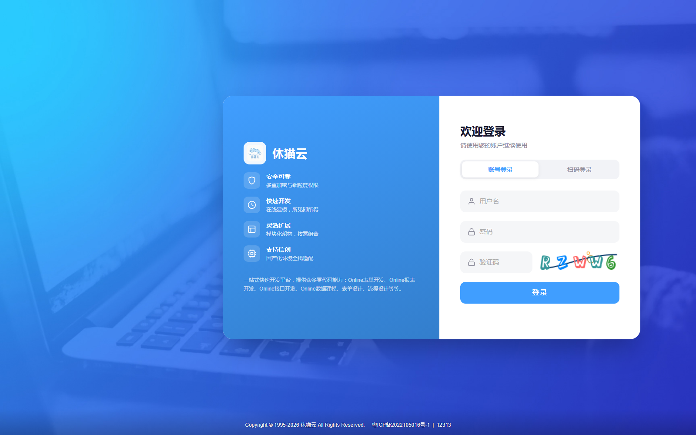

### 2.2 首页工作台（PC 端）

登录后进入真实数据工作台：顶部问候横幅，四张统计卡（今日登录 / 未读消息 / 最近请求 / 在线用户），快捷入口宫格，近 14 日请求趋势图与最近操作/请求动态。菜单完全由数据库驱动，随角色权限动态渲染。

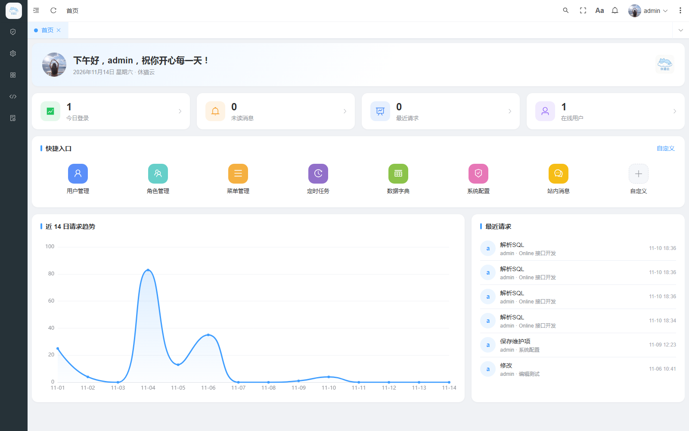

---

## 三、功能说明

平台功能按左侧顶级菜单组织，分为 **权限管理、系统设置、应用管理、日志管理、在线开发** 五大板块。

### 3.1 权限管理

- **用户管理**：账号的增删改查、状态启停、角色分配、导入导出、密码重置。
- **角色管理**：角色定义与菜单/按钮级权限勾选授权，权限实时生效（重新登录后刷新）。

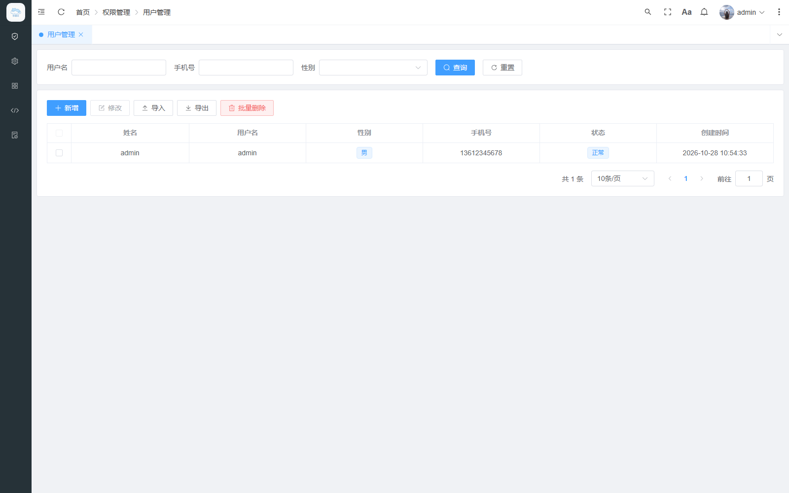

### 3.2 系统设置

- **菜单管理**：菜单/目录/按钮三级结构维护，图标、路由、权限标识、排序、显示隐藏全部可视化配置。系统所有页面入口均由此表驱动。
- **数据字典**：字典类型与字典项维护，供全平台下拉、标签统一取数。
- **定时任务**：基于 Quartz 的任务调度，支持 Cron 表达式、启停、立即执行与执行日志。
- **系统维护**：单行配置统一维护系统名称、Logo、登录验证码开关，以及登录页版权/ICP/公安备案文案。

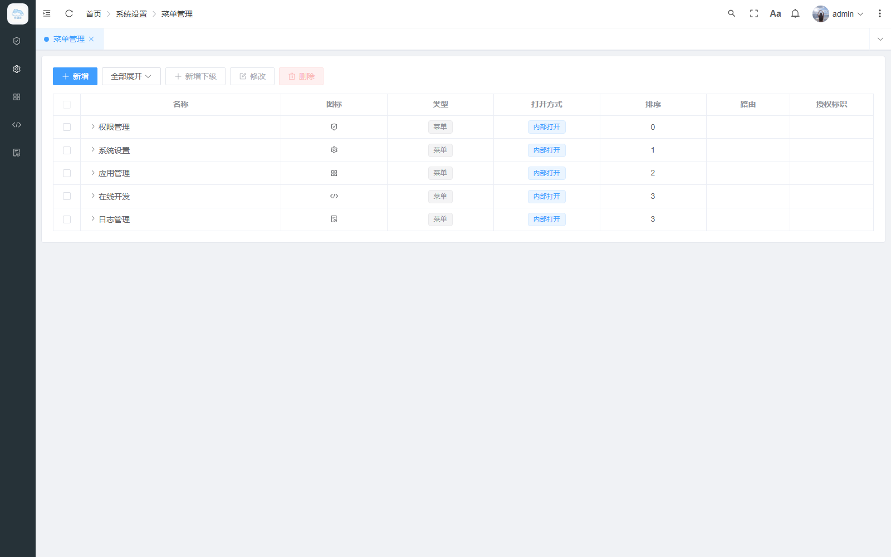

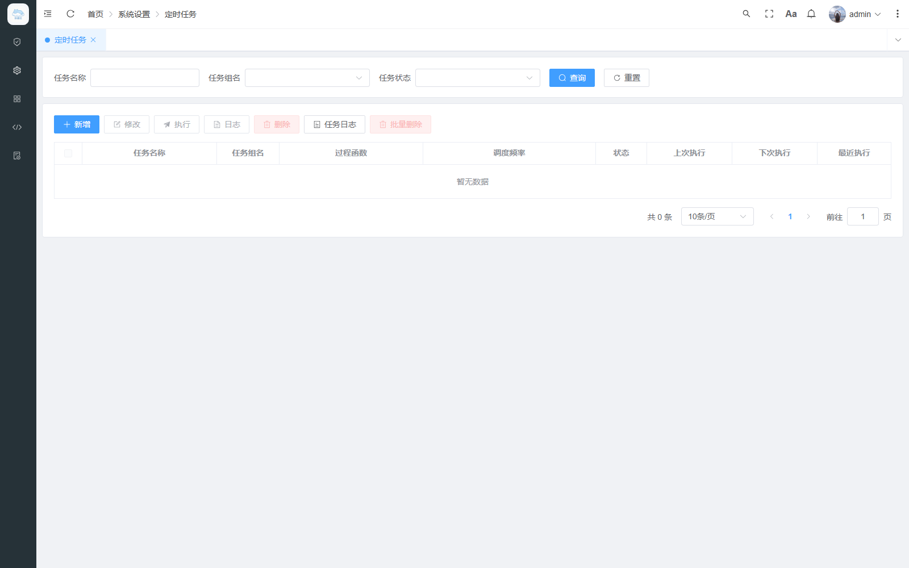

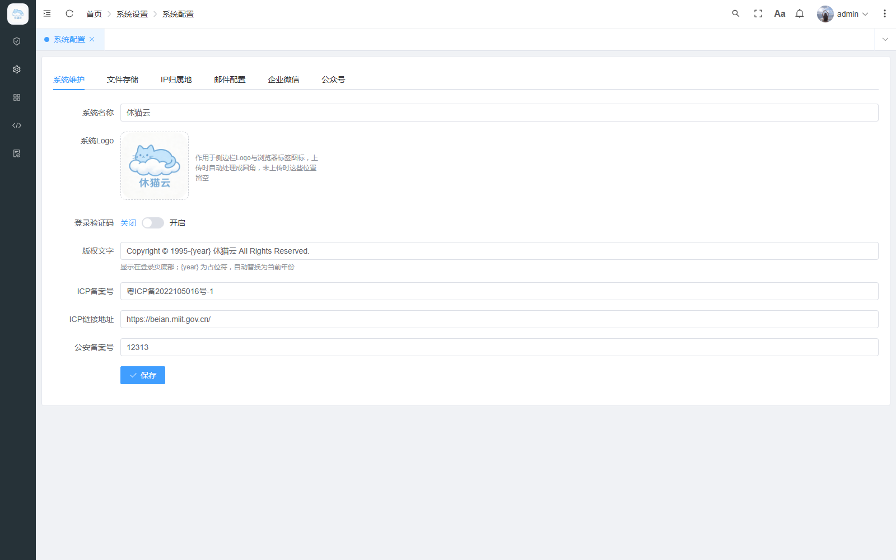

### 3.3 应用管理

- **消息中心**：站内消息（指定用户/全员/后台/模板/过程函数发送）与消息模板管理，支持已读/未读统计。
- **邮件服务**：本地 SMTP 邮件发送与邮件模板管理。
- **微信服务**：公众号模板、企微模板配置。
- **文件管理**：附件上传与管理，图片/视频/PDF 在线预览，访问域名运行时自适应。
- **系统监控**：服务监控（JVM/内存/CPU）、缓存监控、在线用户、系统更新。

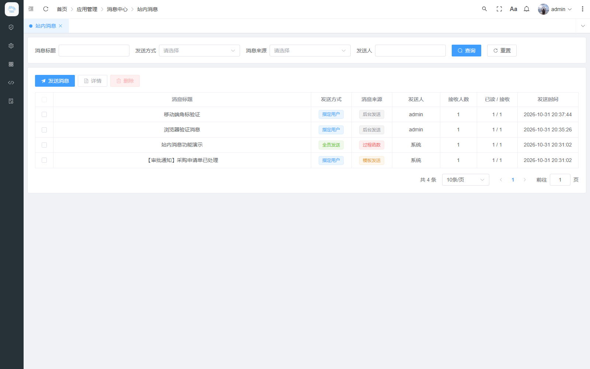

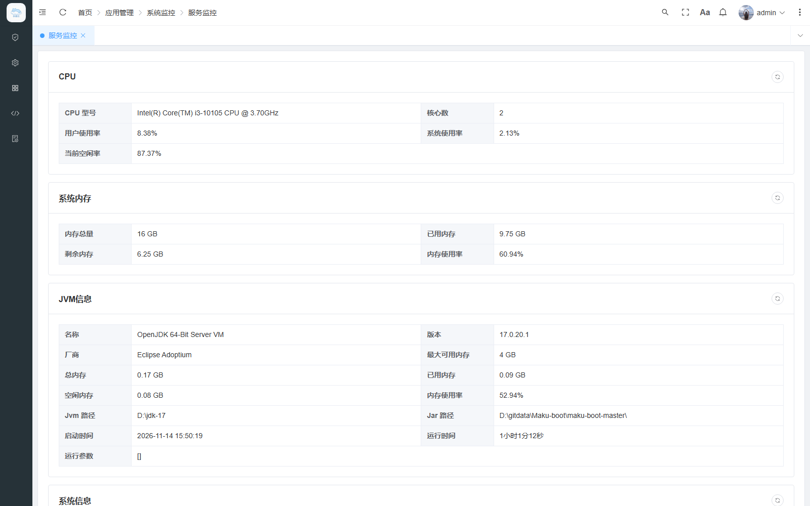

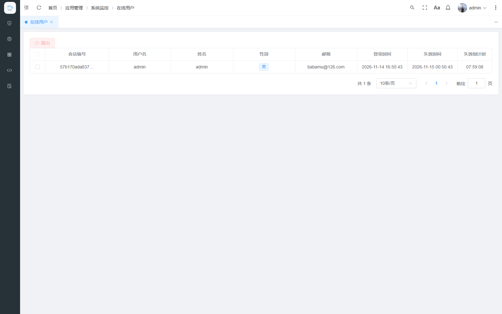

### 3.4 日志管理

登录日志、操作日志、服务日志、企微日志、公众号日志。其中 **服务日志** 提供服务器端日志的在线查看：按文件/行数/级别/关键字筛选，级别着色、堆栈整组折叠、关键字高亮、自动刷新，日志按天切分并自动压缩。

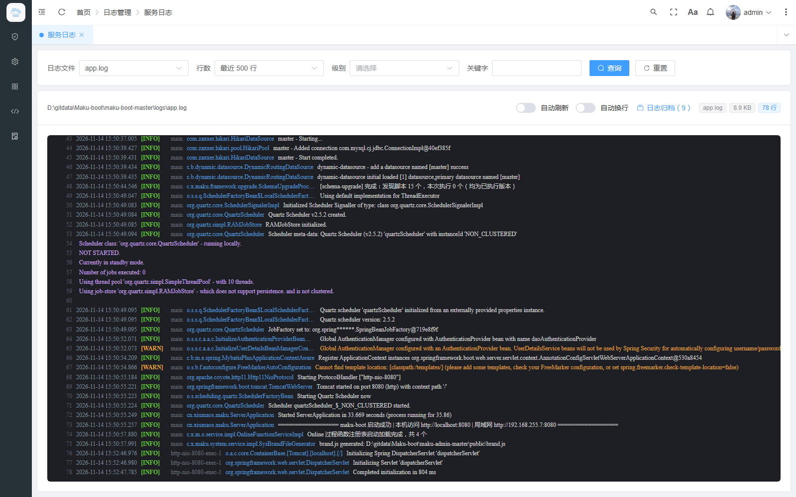

### 3.5 在线开发（核心能力）

在线开发是平台的差异化能力，在「在线开发」顶级目录下包含八项子功能：

| 功能 | 说明 |
| --- | --- |
| **Online 表单开发** | 五步向导（基础信息 / 表单设计 / 列表配置 / 逻辑配置 / 后端逻辑）拖拽式搭建 CRUD 页面，支持主从表（一对一 / 一对多）、引用已有表、change 联动、按钮级权限、菜单一键生成 |
| **Online 报表开发** | 用一条 SELECT 定义报表，解析 SQL 得到结果列并配置显示/查询/字典，运行时动态拼 WHERE + 分页 + 导出 |
| **Online 接口开发** | 用带 `#{参数}` 占位符的 SELECT（或引用过程函数）定义只读数据接口，统一入口对外暴露，含接口预览测试 |
| **Online 数据建模** | 表单式字段清单设计数据库表，保存即生成并执行真实 DDL（建表/加列/改列），支持导入已有表 |
| **Online 过程函数** | 可复用的服务端函数库（内置 util/db/sql/http/redis/mail 等对象），供表单/接口调用 |
| **Online 数据查询** | 内置数据库管理，在线浏览表结构与数据 |
| **Online 系统脚本** | 平台级脚本任务 |
| **Online 单据类型** | 单据编号规则统一管理 |

**表单开发列表**：以向导方式管理已定义的在线表单，支持创建/修改菜单、按钮权限同步。

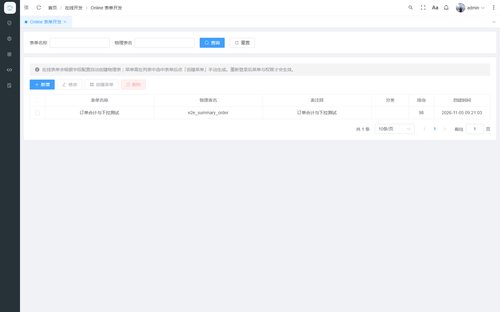

**表单设计器**：左侧 20+ 基础/高级控件，中间主表 + 从表拖拽画布，右侧字段属性与表单配置，所见即所得。

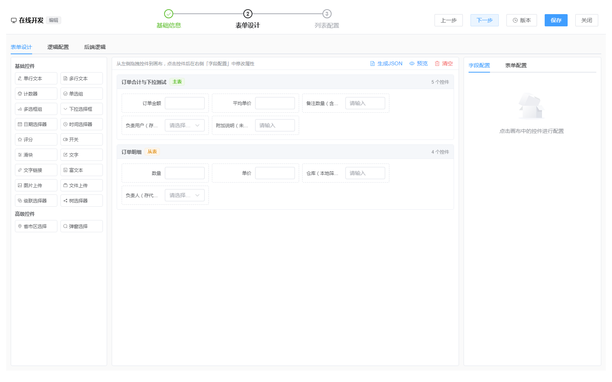

**运行时数据页**：表单生成的实际业务页面，示例「订单合计与下拉测试」（主表 + 订单明细从表，一对多）展示主从表录入、从表整表覆盖、列合计（求和/平均值）、下拉字典过滤与查询条件等能力。

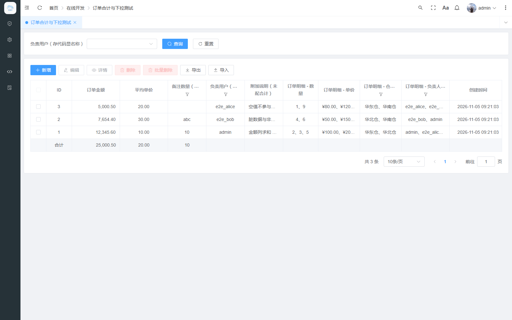

**报表 / 接口 / 建模**：三条独立向导，覆盖 SQL 定义、字段/参数配置与菜单生成。

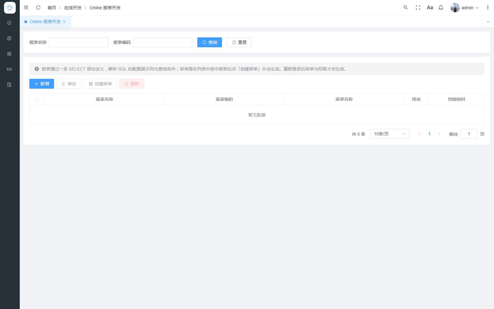

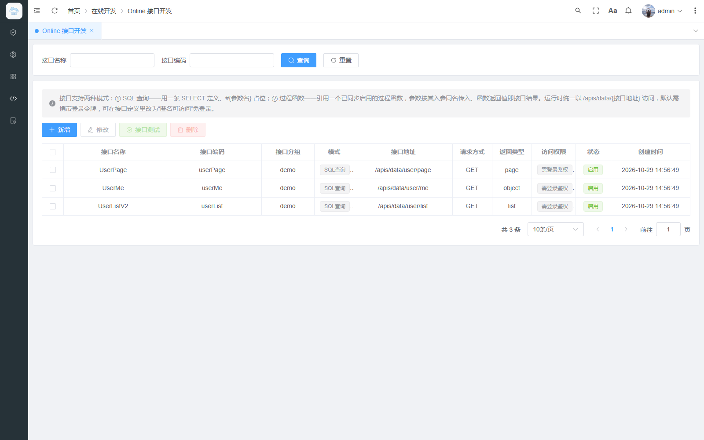

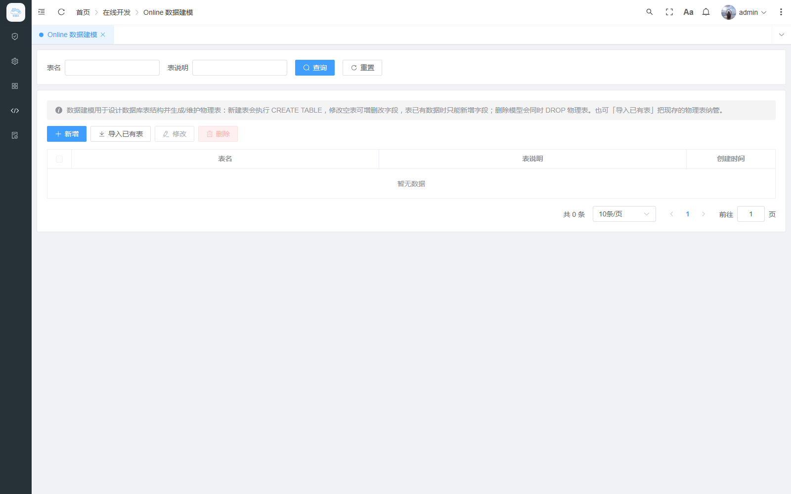

---

## 四、移动端（H5）说明

平台前端为**响应式**设计：当浏览器/手机屏宽 ≤ 768px 时自动切换为移动端布局，无需单独安装 App。移动端有独立的交互范式：

- **底部 3 项导航**：主页 / 应用 / 个人中心。
- **顶部标题栏**：居中标题，右侧「筛选」按钮（仅当前页有查询条件时出现）。
- **查询条件抽屉**：列表页的查询卡片在移动端被自动收纳进「筛选条件」抽屉，桌面端零改动复用。
- **宽表卡片化**：列数较多的列表（如站内消息）在移动端改为卡片流，避免横向滚动。
- **分页强制单行**：窄屏下自动隐藏「每页条数 / 跳至页」，保留总条数与页码导航。

### 4.1 移动端登录

自适应手机竖屏，账号/扫码登录与品牌信息同样呈现。

### 4.2 移动端首页工作台

蓝色渐变问候横幅 + 一行四统计卡 + 快捷入口宫格 + 最近访问，数据与 PC 端同源。

### 4.3 应用宫格

按一级菜单分组的全部功能入口，彩色图标 + 搜索框，替代 PC 左侧菜单树。

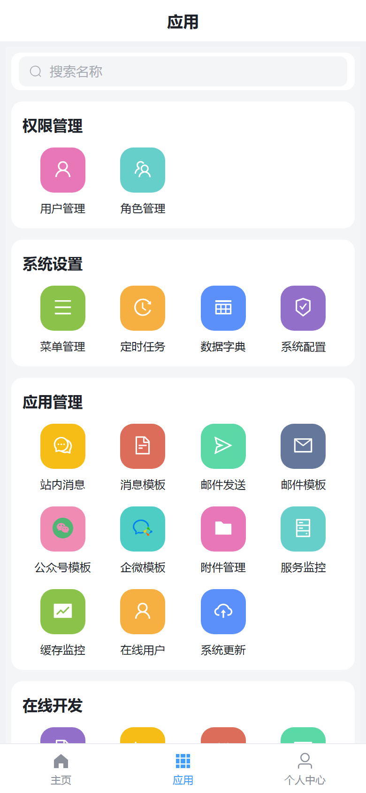

### 4.4 个人中心「我的」

个人信息卡 + 菜单列表（基本资料 / 修改密码 / 个人签名 / 退出登录），子页在同一组件内切换，表单标签自动改为顶部对齐、按钮整行。

### 4.5 移动端列表与数据页

列表页工具栏自适应收纳（放不下时归入「更多」），宽表转卡片；在线表单运行时页面同样支持移动端录入与查看。

---

## 五、安全特性

平台按企业安全基线与渗透测试整改要求做了系统性加固：

- **传输加密**：登录密码国密 SM2 加密 + 一次性 nonce 防重放；在线开发请求体采用**会话级动态 SM4 密钥**（登录/刷新时按会话随机下发，与 token 绑定，非硬编码）。
- **身份与会话**：AccessToken / RefreshToken 双令牌，Redis 存储与失效控制；扫码登录基于「验证器 + 信任设备（凭据 + 浏览器指纹）」。
- **访问控制**：菜单 + 按钮级细粒度权限（`@PreAuthorize`），在线表单/报表/接口运行时二次鉴权。
- **数据侧防护**：SQL 语句只读校验与危险关键字拦截、后端 Groovy 脚本禁用高危 API、文件上传类型白名单与文件名规范化、SSRF 防护、敏感配置回显脱敏。
- **默认口令治理**：内置「弱口令/首次登录强制修改密码」标志位，登录后引导改密。

---

## 六、部署与运行

- **后端**：`mvn -B -DskipTests clean package` → `java -jar target/maku-boot.jar`，端口 `8080`。
- **前端**：`npm install` → `npm run dev`（开发）/ `npm run build`（生产静态资源），开发端口 `3000`。
- **发布包**：仓库根 `build.bat` 一键产出 jar + 前端 dist + 启停脚本到 `dis` 目录，配合 nginx 同源反向代理部署。
- **默认账号**：`admin / admin`（生产环境请立即通过强制改密修改）。
---

## 七、打赏

如果想支持本项目，可以投喂UP (｀･ω･´)ゞ敬礼っ

如果需要项目源码，请联系 web0814@qq.com ；注意！！！源码需要打赏了才能获取！！！
